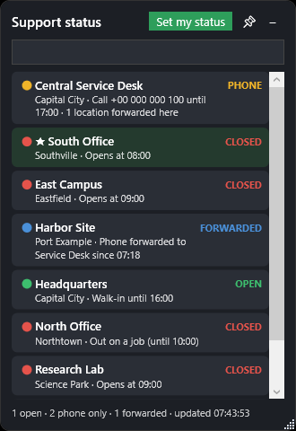
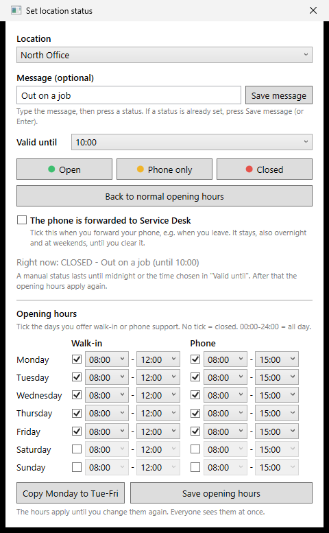

# Support Status

A small Windows desktop widget that shows, for every IT support location, whether it is
**OPEN** (walk-in), **PHONE** (phone only), **CLOSED** or **FORWARDED** (its phone is forwarded to a central service desk), right now.

It needs **no server, database, cloud service or internet access**. All PCs read a few small JSON
files from one shared network folder. That makes it a good fit for closed or restricted networks.

<p>
  
  &nbsp;
  
</p>

## Features

- Live status for every location, refreshed every 30 seconds
- Opening hours per weekday (walk-in and phone), including weekends and 24-hour days
- Site staff can set a manual status (Open / Phone only / Closed) with a message, valid until midnight or a chosen time. After that, the normal opening hours apply again automatically
- "Phone forwarded to the central desk" flag. The central desk sees how many locations are forwarded to it
- The central desk is always pinned at the top; the rest are sorted alphabetically
- Each user can star their own location (stored per user)
- Click a location to see phone, email, address and hours, with **Copy** buttons
- Search by name, town or address
- Tray icon (next to the clock) whose colour follows the user's own location
- Single instance per user, runs without admin rights, no installer, no telemetry

## How it works

```
                    \\fileserver\SupportStatus\
                    ├─ locations.json          (all locations, maintained by IT admins)
                    ├─ hours\<id>.json         (opening hours, set by site staff)
                    └─ overrides\<id>.json     (manual status, set by site staff)
                       └─ forward\<id>.json    (phone forwarded to the central desk)
                                 ▲
     every PC reads the folder every 30 s  │  site staff (/admin) write small files
                                 │
        SupportStatus.exe on each PC  ──  works out the status locally from the PC's clock
```

Status precedence:

1. Phone forwarded to the central desk (`overrides\forward\<id>.json` exists)
2. Manual status (`overrides\<id>.json`), if it has not expired
3. Within today's walk-in hours → **OPEN**
4. Within today's phone hours → **PHONE**
5. Otherwise **CLOSED** (with "Opens at …" if it opens later today)

Every location has its own files, so two sites never overwrite each other. Files are written to a
`.tmp` file first and then renamed, so no PC ever reads a half-written file.

## Try it in one minute

Requirements: Windows 10/11 and the [.NET 8 SDK](https://dotnet.microsoft.com/download/dotnet/8.0).

```powershell
git clone <this repository>
cd SupportStatus
dotnet run -- /admin
```

The app starts with the demo data in `SampleData\` (8 made-up locations). `/admin` shows the
**Set my status** button so you can try the admin window.

## Setting it up for real

### 1. Create the shared folder

1. Create a folder on a file server, e.g. `\\fileserver\SupportStatus`.
2. Copy `SampleData\locations.json` into it and replace the demo locations with your own (see below).
3. Set NTFS permissions using **AD groups** (not OUs. NTFS permissions can only be set on users and groups):

| Folder | Everyone who should see the status | Site staff group | IT admins |
| --- | --- | --- | --- |
| `SupportStatus` | Read | Read | Modify (to edit `locations.json`) |
| `SupportStatus\overrides` | Read | Modify | Modify |
| `SupportStatus\hours` | Read | Modify | Modify |

The permissions are the real security. The `/admin` switch only shows the button; without write
access, saving fails with "Could not save …".

### 2. Configure `settings.json` (next to the exe)

```json
{
  "SharePath": "\\\\fileserver\\SupportStatus",
  "MyLocationId": "",
  "RefreshSeconds": 30,
  "CentralName": "Service Desk"
}
```

| Setting | Meaning |
| --- | --- |
| `SharePath` | Path to the shared folder. In JSON every `\` is written as `\\`. A UNC path (`\\server\share`) is recommended over a mapped drive letter, because drive letters can differ per user and may not be connected yet when the app starts at login. A relative path (like `SampleData`) is resolved from the exe folder. |
| `MyLocationId` | Optional default "own" location (★). Users can choose their own by right-clicking; their choice is stored in `%APPDATA%\SupportStatus\user.json`. |
| `RefreshSeconds` | How often to re-read the folder (minimum 5). |
| `CentralName` | Name of the central desk that phones are forwarded to. Shown in texts like "Phone forwarded to Service Desk". |

### 3. Build and deploy

Build one self-contained exe (no .NET installation needed on the PCs):

```powershell
dotnet publish SupportStatus.csproj -c Release -r win-x64 --self-contained true `
  -p:PublishSingleFile=true -p:IncludeNativeLibrariesForSelfExtract=true `
  -p:EnableCompressionInSingleFile=true -p:DebugType=none -o publish
```

Then:

1. Copy `SupportStatus.exe` and your `settings.json` to e.g. `C:\Program Files\SupportStatus\` (GPO, Intune, SCCM, or by hand). Do not copy the `SampleData` folder.
2. Add a shortcut to the exe in `C:\ProgramData\Microsoft\Windows\Start Menu\Programs\StartUp` so it starts for all users at login.
3. For site staff, the shortcut gets `/admin` at the end:
   ```
   "C:\Program Files\SupportStatus\SupportStatus.exe" /admin
   ```
   Deploy that shortcut only to the site staff (e.g. a GPO shortcut with item-level targeting on their group).
4. Start with 2-3 test PCs before rolling out to everyone.

## Managing locations (`locations.json`)

One location per line:

```json
{"Id": "north", "Name": "North Office", "Region": "Northtown", "PhoneNumber": "+00 000 000 102", "Email": "support-north@example.com", "Address": "2 Example Road, 2000 Northtown", "WalkInHours": "08:00-12:00", "PhoneHours": "08:00-15:00"},
```

| Field | Meaning |
| --- | --- |
| `Id` | Short, unique, lower case, no spaces. It becomes a file name. **Never change it** for an existing location, or it loses its hours, status and forwarding. |
| `Name` | Display name. |
| `Region` | Town or area, shown under the name and searchable. |
| `PhoneNumber`, `Email`, `Address` | Shown when the location is clicked, with Copy buttons. Empty values are hidden. |
| `WalkInHours`, `PhoneHours` | Default hours Mon-Fri, e.g. `08:00-12:00`. `""` = none. Weekends are closed. |
| `Week` | Optional hours per weekday, replaces the two fields above. A missing day is closed. `00:00-24:00` = all day. |
| `Pinned` | `true` = always at the top (use it for the central desk). |

Example of `Week`:

```json
"Week": {
  "Monday":   { "WalkIn": "09:00-12:00", "Phone": "09:00-15:00" },
  "Friday":   { "WalkIn": "",            "Phone": "09:00-12:00" },
  "Saturday": { "WalkIn": "",            "Phone": "00:00-24:00" }
}
```

Hours that site staff set in the admin window are saved in `hours\<id>.json` and win over the hours
in `locations.json`.

**Editing safely:** make a copy of the file first, remember the comma after every line except the
last, then check the file. This works without internet access:

```powershell
Get-Content "\\fileserver\SupportStatus\locations.json" -Raw -Encoding UTF8 | ConvertFrom-Json | Measure-Object
```

If it prints a `Count`, the file is valid. If it prints red text, fix the error or restore the copy.
All PCs pick up the change within 30 seconds; nothing needs to be reinstalled.

## Using it

- **Everyone:** see [the user table below](#for-everyone).
- **Site staff:** see [docs/site-staff-guide.md](docs/site-staff-guide.md).

### For everyone

| Action | How |
| --- | --- |
| See phone, email, address and hours | Click a location. Click again to close it. |
| Copy phone, email or address | Click the location and press **Copy**, or right-click it. |
| Star your own location | Right-click it → **★ Make this my location**. It moves up under the central desk, and the tray icon takes its colour. |
| Search | Type in the search box: name, town or address. |
| Hide the window | Press **–**. The app keeps running in the tray. |
| Show it again | Click the round **IT** icon next to the clock (it may be under **^**), or start the app again. |
| Always on top | Press 📌, or right-click the tray icon → **Always on top**. |
| Exit | Right-click the tray icon → **Exit**. It starts again at the next login. |

## Troubleshooting

| Problem | Fix |
| --- | --- |
| The list is empty ("0 open") | `SharePath` is wrong, the user cannot read the folder, or `locations.json` has an error. Open the path in File Explorer as that user, and check the file with the command above. |
| "Cannot reach the status folder" | The folder cannot be reached. Check the network and the path. |
| "Could not save …" | The user lacks Modify on `hours` or `overrides`, or is not in the site staff group. |
| The exe is blocked | The exe is not code-signed. Allow it in your antivirus / AppLocker, or sign it with your own certificate. |
| A change does not show at once | The window refreshes every 30 seconds. |

## Known limitations

- Public holidays are not known; the normal opening hours apply.
- Hours cannot span midnight (e.g. 22:00-06:00). Use `00:00-24:00` for all day.
- The status is worked out from each PC's clock and time zone.
- The window always starts in the bottom right corner (its position is not remembered).
- No logging. Errors are shown in the window footer or as a message in the admin window.

## Security and privacy notes

- The app only reads and writes files in `SharePath` (SMB). It opens no ports, makes no web requests and sends no telemetry.
- Every PC trusts the content of the shared folder, so **the NTFS permissions are what protect it**. Make sure only the intended groups can write.
- Override and forwarding files store the Windows user name of whoever set them, and the time.
- Messages are visible to everyone who can see the status.

## Project structure

| File | Contents |
| --- | --- |
| `App.xaml.cs` | Start-up, single instance, `/admin` switch |
| `MainWindow.xaml(.cs)` | The widget, list, click/copy, star, tray icon, quick forwarding |
| `AdminWindow.xaml(.cs)` | Manual status, message, "Valid until", forwarding, weekly hours |
| `Models.cs` | Data model, reading/writing files, the status rules |
| `SampleData\locations.json` | Demo data (made-up locations) |
| `settings.json` | Settings (see above) |

Built with C#, WPF and .NET 8. No NuGet packages.

## License

[MIT](LICENSE)
